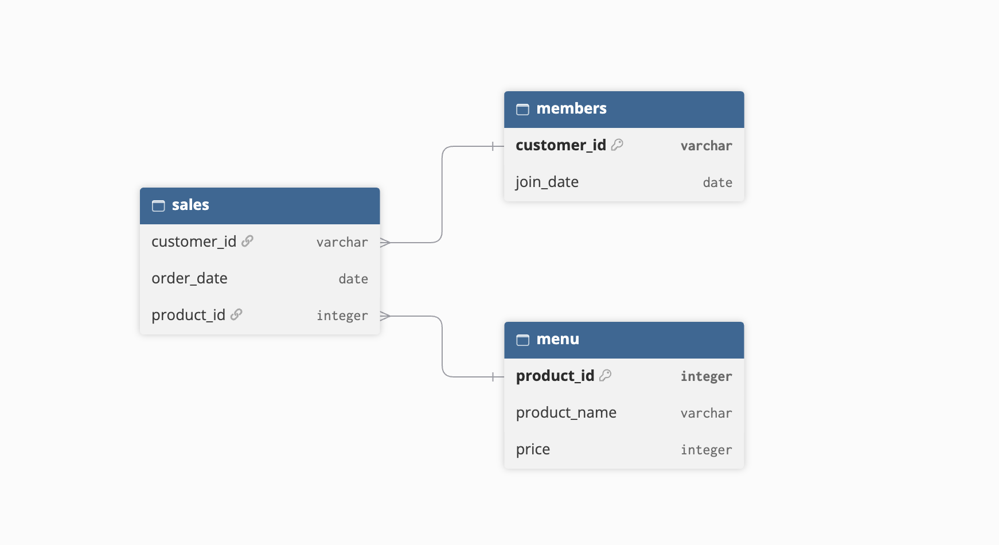

# 🍜 Case Study #1: Danny's Diner

<p align="center">
  <br>
  <strong>Source:</strong> <a href="https://8weeksqlchallenge.com/case-study-1/">8 Week SQL Challenge: Case Study #1 - Danny's Diner</a>
</p>

## Objective
Danny runs a small Japanese restaurant and wants to use customer data to understand visiting patterns, spending, and favorite menu items. The goal is to answer his questions with SQL to help Danny deliver a more personalized experience for loyal customers and decide whether to expand the existing loyalty program.

## Entity Relationship Diagram
Danny has shared 3 key datasets for this dataset:
- `sales` : shows all `customer_id` purchases with the corresponding `order_date` and `product_info` for when and what menu item was ordered.
- `menu` : maps `product_id` to the actual `product_name` and `price` of each menu item.
- `members` : shows the `join_date` when a `customer_id` joined the beta version of the Danny's Diner loyalty program. 
   
<p align="center">

</p>

## Question and Solution
**1. What is the total amount each customer spent at the restaurant?**
```SQL
SELECT sales.customer_id, SUM(menu.price) as total_spending FROM sales
LEFT JOIN menu
    ON sales.product_id = menu.product_id
GROUP BY sales.customer_id
ORDER BY sales.customer_id ASC;
```

**Approach:**
- **JOIN** `sales.product_id` and `menu.product_id` to get the price of each ordered item
- **SUM** `menu.price` to find the total spending for each customer
- **GROUP BY** `sales.customer_id` so each customer gets one total and **ORDER BY** to keep output organized
  
**Solution:**
| customer_id | total_spending |
| --------------- | --------------- |
| A | 76 |
| B | 74 |
| C | 36 |

**2. How many days has each customer visited the restaurant?**
```SQL
SELECT customer_id, COUNT(DISTINCT order_date) FROM sales
GROUP BY customer_id
ORDER BY customer_id ASC;
```

**Approach:**
- **COUNT**(**DISTINCT** `order_date`) counts each day a customer visited once
- **GROUP BY** by `customer_id` so each customer gets one total and **ORDER BY** to keep output organized
  
**Solution:**
| customer_id | count |
| --------------- | --------------- |
| A   | 4   |
| B   | 6   |
| C   | 2   |

**3. What was the first item from the menu purchased by each customer?**
```SQL
WITH first_purchase AS (
    SELECT 
        s.customer_id, 
        s.order_date, 
        m.product_name,
        RANK() OVER (
            PARTITION BY s.customer_id
            ORDER BY s.order_date ASC, s.customer_id ASC
        ) as purchase_rank
    FROM sales s
    INNER JOIN menu m
        ON s.product_id = m.product_id
    GROUP BY s.customer_id, m.product_name, s.order_date
    ORDER BY s.customer_id
)

SELECT customer_id, order_date, product_name FROM first_purchase 
WHERE purchase_rank = 1;
```

**Approach:**
- Create a **CTE** called `first_purchase` and inside, use a **RANK** to rank each customer's order by order date, using **PARTITION BY** `s.customer_id` so each customer is ranked searately
- **JOIN** to `menu` on `product_id` to get the product name
- **SELECT** from `first_purchase` and set a **WHERE** condition to return each customer's first purchase
  
**Solution:**
| customer_id | order_date | product_name |
| --------------- | --------------- | --------------- |
| A   | 2021-01-01   | curry   |
| A   | 2021-01-01   | sushi   |
| B   | 2021-01-01   | curry   |
| C   | 2021-01-01   | ramen   |

**4. What is the most purchased item on the menu and how many times was it purchased by all customers?**
```SQL
SELECT menu.product_name, COUNT(sales.product_id) FROM sales
INNER JOIN menu
    ON sales.product_id = menu.product_id
GROUP BY menu.product_name
ORDER BY COUNT(sales.product_id) DESC
LIMIT 1;
```

**Approach:**
- **JOIN** `sales.product_id` and `menu.product_id`  to get the product name of every customer order
- **COUNT** `sales.product_id` and **GROUP BY** to get the number of times each item was purchased
- **ORDER BY** the count **DESC** and **LIMIT** to return only the top purchased item
  
**Solution:**
| product_name | count   |
| --------------- | --------------- |
| ramen   | 8   |

**5. Which item was the most popular for each customer?**
```SQL
WITH first_pruchase AS (
    SELECT 
        s.customer_id, 
        COUNT(s.product_id) AS order_count, 
        m.product_name,
        DENSE_RANK() OVER (
            PARTITION BY s.customer_id
            ORDER BY COUNT(s.product_id) DESC
        ) as purchase_rank
    FROM sales s
    INNER JOIN menu m
        ON s.product_id = m.product_id
    GROUP BY s.customer_id, m.product_name
    ORDER BY s.customer_id
)
SELECT customer_id, order_count, product_name FROM first_pruchase 
WHERE purchase_rank = 1;
```

**Approach:**
- Create a **CTE** called `first_purchase`, that **JOINs** `sales` to `menu`, then **COUNTs** each item per customer with **GROUP BY**
- Use **DENSE_RANK** with **PARTITION BY** `s.customer_id`, **ORDER BY** the count **DESC** so each customer's top item ranks 1 and ties are kept
- **SELECT** `customer_id`, `order_count`, `product_name` from the CTE `first_purchase` **WHERE** rank = 1

**Solution:**
| customer_id | order_count | product_name |
| --------------- | --------------- | --------------- |
| A   | 3   | ramen   |
| B   | 2   | sushi   |
| B   | 2   | curry   |
| B   | 2   | ramen   |
| C   | 3   | ramen   |

6. Which item was purchased first by the customer after they became a member?
```SQL
WITH first_purchase AS(
    SELECT
        mb.customer_id,
        mb.join_date,
        s.order_date,
        m.product_name,
        DENSE_RANK() OVER(
            PARTITION BY mb.customer_id
            ORDER BY s.order_date, mb.customer_id
        ) as purchase_rank
    FROM members mb 
    INNER JOIN sales s
        ON mb.customer_id = s.customer_id
    INNER JOIN menu m 
        ON m.product_id = s.product_id
    WHERE s.order_date > mb.join_date
    ORDER BY mb.customer_id, s.order_date
)

SELECT customer_id, join_date, order_date, product_name FROM first_purchase
WHERE purchase_rank = 1;
```

**Approach:**
- Create a **CTE** that **JOINs** `members` to `sales` and `sales` to `menu`, **WHERE** it only keeps the orders after a customer becomes a member
- Use **DENSE_RANK** with **PARTITION BY** `mb.customer_id` and **ORDER BY** `s.order_date` so each customer's order is ranked by their order date from earliest to latest
- **SELECT** from the **CTE WHERE** rank = 1

**Solution:**
| customer_id | join_date | order_date | product_name |
| --------------- | --------------- | --------------- | --------------- |
| A   | 2021-01-07   | 2021-01-10   | ramen   |
| B   | 2021-01-09   | 2021-01-11   | sushi   |

7. Which item was purchased just before the customer became a member?
```SQL
WITH latest_purchase AS(
    SELECT
        mb.customer_id,
        mb.join_date,
        s.order_date,
        m.product_name,
        DENSE_RANK() OVER(
            PARTITION BY mb.customer_id
            ORDER BY s.order_date DESC, mb.customer_id
        ) as purchase_rank
    FROM members mb 
    INNER JOIN sales s
        ON mb.customer_id = s.customer_id
    INNER JOIN menu m 
        ON m.product_id = s.product_id
    WHERE s.order_date < mb.join_date
    ORDER BY mb.customer_id, s.order_date
)

SELECT customer_id, join_date, order_date, product_name FROM latest_purchase
WHERE purchase_rank = 1;
```

**Approach:**
- Same **CTE** structure as Question 6, but filter for orders before the `mb.join_date`
- Rank with **DENSE RANK** ordered by `s.order_date` **DESC**, so each customer's most recent order ranks 1

**Solution:**
| customer_id | join_date | order_date | product_name |
| --------------- | --------------- | --------------- | --------------- |
| A   | 2021-01-07   | 2021-01-01   | sushi   |
| A   | 2021-01-07   | 2021-01-01   | curry   |
| B   | 2021-01-09   | 2021-01-04   | sushi   |

8. What is the total items and amount spent for each member before they became a member?
```SQL
SELECT mb.customer_id, COUNT(s.product_id) AS order_count, SUM(m.price) AS total_spend FROM members mb
INNER JOIN sales s
    ON mb.customer_id = s.customer_id
INNER JOIN menu m 
    ON m.product_id = s.product_id
WHERE mb.join_date > s.order_date
GROUP BY mb.customer_id, s.customer_id
ORDER BY s.customer_id;
```

**Approach:**
- **JOIN** all three tables: `members`, `sales`, `menu` so each order has a price and a join date
- **WHERE** `mb.join_date > s.order_date` to keep only the orders before a customer becomes a member
- **COUNT** `s.product_id` for total items and **SUM** `m.price` for total spent, **GROUP BY** `customer_id`

**Solution:**
| customer_id | order_count | total_spend |
| --------------- | --------------- | --------------- |
| A   | 2   | 25   |
| B   | 3   | 40   |

9. If each $1 spent equates to 10 points and sushi has a 2x points multiplier - how many points would each customer have?
```SQL
SELECT
    s.customer_id,
    SUM(
        CASE
            WHEN m.product_name = 'sushi' THEN m.price * 20
            ELSE m.price * 10
        END
    ) AS total_points_earned
FROM sales s 
INNER JOIN menu m ON s.product_id = m.product_id
GROUP BY s.customer_id
ORDER BY customer_id;
```

**Approach:**
- **JOIN** sales with menu on `product_id` to get each item's price
- **SUM** a **CASE** statement called `total_points_earned`, **WHEN** a `product_name = sushi` then the customer earns double the points, if not, every dollar spend is 10 points
- GROUP BY `customer_id`
  
**Solution:**
| customer_id | total_points_earned   |
| --------------- | --------------- |
| A   | 860   |
| B   | 940   |
| C   | 360   |

10. In the first week after a customer joins the program (including their join date) they earn 2x points on all items, not just sushi - how many points do customer A and B have at the end of January?
```SQL
SELECT
    mb.customer_id,
    SUM(
        CASE
            WHEN s.order_date BETWEEN mb.join_date AND mb.join_date + INTERVAL '6 days' THEN m.price * 20
            WHEN m.product_name = 'sushi' THEN m.price * 20
            ELSE m.price * 10
        END
    ) AS total_points_earned
FROM members mb 
INNER JOIN sales s ON mb.customer_id = s.customer_id
INNER JOIN menu m ON s.product_id = m.product_id
WHERE EXTRACT(MONTH FROM s.order_date) = 1
GROUP BY mb.customer_id
ORDER BY customer_id;
```

**Approach:**
- JOIN all three tables: `members`, `sales`, `menu`
- SUM a CASE statement called `total_points_earned`, WHEN a customer orders the first week after they became a member `(order_date from join_date through join_date + 6)`, they earn double the points, or if they purchase `sushi` then the customer earns double the points, if not, every dollar spend is 10 point
- WHERE EXTRACT(MONTH FROM s.order_date) = 1 only looks at orders in the 1st month of the year, January
  
**Solution:**
| customer_id | total_points_earned   |
| --------------- | --------------- |
| A   | 1370   |
| B   | 820   |

**Bonus Questions**
**1. Join all the things**
```SQL
SELECT 
    s.customer_id,
    s.order_date,
    m.product_name,
    m.price,
    CASE
        WHEN mb.join_date <= s.order_date THEN 'Y'
        ELSE 'N'
    END AS member
FROM members mb
FULL JOIN sales s ON mb.customer_id = s.customer_id 
FULL JOIN menu m ON s.product_id = m.product_id
ORDER BY s.customer_id, s.order_date;
```

| customer_id | order_date | product_name | price | member |
| ----------- | ---------- | ------------ | ----- | ------ |
| A | 2021-01-01 | curry | 15 | N |
| A | 2021-01-01 | sushi | 10 | N |
| A | 2021-01-07 | curry | 15 | Y |
| A | 2021-01-10 | ramen | 12 | Y |
| A | 2021-01-11 | ramen | 12 | Y |
| A | 2021-01-11 | ramen | 12 | Y |
| B | 2021-01-01 | curry | 15 | N |
| B | 2021-01-02 | curry | 15 | N |
| B | 2021-01-04 | sushi | 10 | N |
| B | 2021-01-11 | sushi | 10 | Y |
| B | 2021-01-16 | ramen | 12 | Y |
| B | 2021-02-01 | ramen | 12 | Y |
| C | 2021-01-01 | ramen | 12 | N |
| C | 2021-01-01 | ramen | 12 | N |
| C | 2021-01-07 | ramen | 12 | N |

**2. Rank all the things**
```SQL
WITH member_status AS (
    SELECT 
        s.customer_id,
        s.order_date,
        m.product_name,
        m.price,
        CASE
            WHEN mb.join_date <= s.order_date THEN 'Y'
            ELSE 'N'
        END AS member
    FROM members mb
    FULL JOIN sales s ON mb.customer_id = s.customer_id 
    FULL JOIN menu m ON s.product_id = m.product_id
    ORDER BY s.customer_id, s.order_date
),
ranking_status AS (
    SELECT
        customer_id,
        order_date,
        product_name,
        price,
        member,
        CASE
            WHEN member = 'Y' THEN 
            RANK() OVER(
                PARTITION BY customer_id, member
                ORDER BY order_date
            )
            ELSE NULL
        END AS ranking
    FROM member_status
)

SELECT customer_id, order_date, product_name, price, member, ranking FROM ranking_status;
```

| customer_id | order_date | product_name | price | member | ranking |
| ----------- | ---------- | ------------ | ----- | ------ | ------- |
| A | 2021-01-01 | curry | 15 | N | NULL |
| A | 2021-01-01 | sushi | 10 | N | NULL |
| A | 2021-01-07 | curry | 15 | Y | 1 |
| A | 2021-01-10 | ramen | 12 | Y | 2 |
| A | 2021-01-11 | ramen | 12 | Y | 3 |
| A | 2021-01-11 | ramen | 12 | Y | 3 |
| B | 2021-01-01 | curry | 15 | N | NULL |
| B | 2021-01-02 | curry | 15 | N | NULL |
| B | 2021-01-04 | sushi | 10 | N | NULL |
| B | 2021-01-11 | sushi | 10 | Y | 1 |
| B | 2021-01-16 | ramen | 12 | Y | 2 |
| B | 2021-02-01 | ramen | 12 | Y | 3 |
| C | 2021-01-01 | ramen | 12 | N | NULL |
| C | 2021-01-01 | ramen | 12 | N | NULL |
| C | 2021-01-07 | ramen | 12 | N | NULL |

## Challenges

## Key Takeaways
