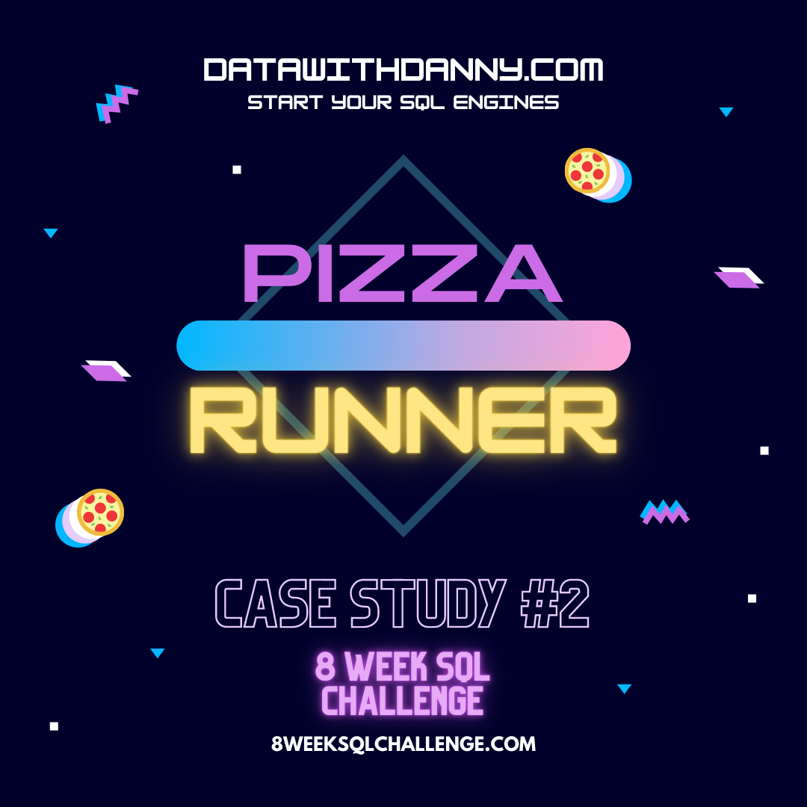
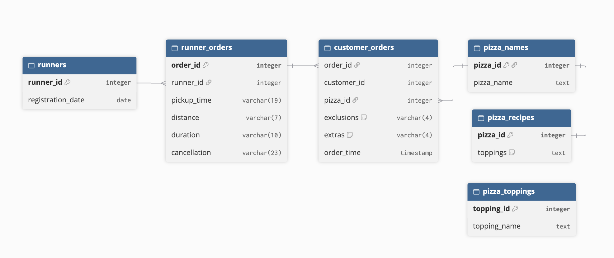

# 🍕 Case Study #2: Pizza Runner

 
  <strong>Source:</strong> <a href="https://8weeksqlchallenge.com/case-study-2/">8 Week SQL Challenge: Case Study #2 - Pizza Runner</a>

## Table of Contents
- [Objective](#objective)
- [Entity Relationship Diagram](#entity-relationship-diagram)
- [Data Cleaning](#data-cleaning)
- [Question & Solution](#question-and-solution)
- [Challenge](#challenges)
- [Key Takeaway](#key-takeaways)
  
## Objective
This case study analyzes Pizza Runner’s order, runner, and delivery data to uncover insights on customer ordering behavior, runner performance, ingredient usage, and revenue, so Danny can make data-driven decisions to grow his pizza delivery business.

## Entity Relationship Diagram
There are 6 key datasets for this case study:
  - `runners` : Runner registration dates
  - `customer_orders` : One row per pizza ordered
  - `runner_orders` : One row per order, with pickup/delivery details and `cancellation` status
  - `pizza_names` : The two pizzas: Meat Lovers and Vegetarian
  - `pizza_recipes` : Standard toppings for each `pizza_id`
  - `pizza_toppings` : Topping names and their `topping_id`

## Data Cleaning
Before investigating the data, I had to clean the dataset by handling the `null` values and data types in the `customer_orders` and `runner_orders` tables.
- `customer_orders`: converted blank and `'null'` values in `exclusions` and `extras` to NULL
- `runner_orders`: similar fix for `cancellation`, and I turned `pickup_time`, `distance`, and `duration` into usable data types

[View the full script](./data_cleaning.sql)

## Question and Solution
This is a lengthy case study, thus, it is divided into five sections:

**[A. Pizza Metrics](https://github.com/renalcalde/Data-Projects/blob/483c9579b22bb103fe7c453e0cebea1c9778b6ff/8%20Week%20SQL%20Challenge/Case%20Study%20%232%3A%20Pizza%20Runner/Solutions/A.%20Pizza%20Metrics.md)**: Order volume, delivery success, and pizza type popularity across customers.

**[B. Runner and Customer Experience](https://github.com/renalcalde/Data-Projects/blob/main/8%20Week%20SQL%20Challenge/Case%20Study%20%232%3A%20Pizza%20Runner/Solutions/B.%20Runner%20and%20Customer%20Experience.md)**: Runner signups, pickup times, delivery speed, and how distance affects performance.

**[C. Ingredient Optimisation](https://github.com/renalcalde/Data-Projects/blob/main/8%20Week%20SQL%20Challenge/Case%20Study%20%232%3A%20Pizza%20Runner/Solutions/C.%20Ingredient%20Optimisation.md)**: Standard toppings, exclusions, and extras, including building ingredient lists for each order.

**[D. Pricing and Ratings](https://github.com/renalcalde/Data-Projects/blob/main/8%20Week%20SQL%20Challenge/Case%20Study%20%232%3A%20Pizza%20Runner/Solutions/D.%20Pricing%20and%20Ratings.md)**: Revenue calculations, extra topping charges, and a new ratings table for runner performance.

**[E. Bonus Questions](https://github.com/renalcalde/Data-Projects/blob/main/8%20Week%20SQL%20Challenge/Case%20Study%20%232%3A%20Pizza%20Runner/Solutions/E.%20Bonus%20Questions.md)**: Extending the menu by adding a new pizza and updating the related tables.

## Challenges
- Runner and Customer Experience (timestamps): Most questions in this section required manipulating timestamps, which introduced concepts I was unfamiliar with, including casting, EXTRACT(), and applying mathematical formulas. Getting the math and data types right took trial and error.
- Ingredient Optimisation (Q4): This was the most challenging question because it combined several new concepts at once: cleaning NULLs, splitting comma-separated IDs into integer arrays, STRING_AGG, and COALESCE.

## Key Takeaways
**Business Insights**
- Bacon is the most popular extra (added 4 times), while Cheese is the most frequently excluded topping (excluded 4 times).
- Orders peak in the afternoon (1-6 PM) and again in the late evening (9-11 PM).
- Larger orders take longer to prepare. A single pizza averaged about 12 minutes, while orders of three took about 29. Prep time doesn’t scale perfectly with pizza count, but the trend is upward.
- Runner 2 has the highest average speed, but that average hides inconsistency. On deliveries of about the same distance, Runner 2’s speed varies widely, so the average isn’t a reliable predictor of any given delivery. Runner 1 and Runner 3 are slower on average but more consistent.

**Technical Skills**
- **Data cleaning**: Converted empty strings and the text 'null' into true NULLs and cast values to proper data types.
- **Working with timestamps**: Calculated time gaps by subtracting timestamps, converted intervals to minutes with EXTRACT(), cast results to the proper data type, and used a fixed date anchor to define custom weeks.
- **Applying formulas in SQL**: Translated real-world calculations into queries, including speed in km/h, success rate as a percentage, revenue with per-extra charges, and profit after runner costs.
- **Subqueries and CTEs**: Used subqueries and CTEs to break multi-step problems into readable pieces.
