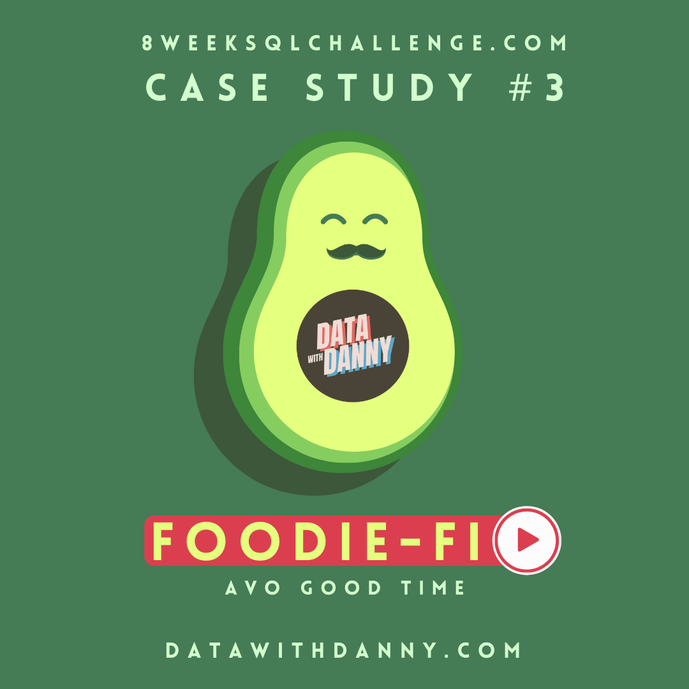
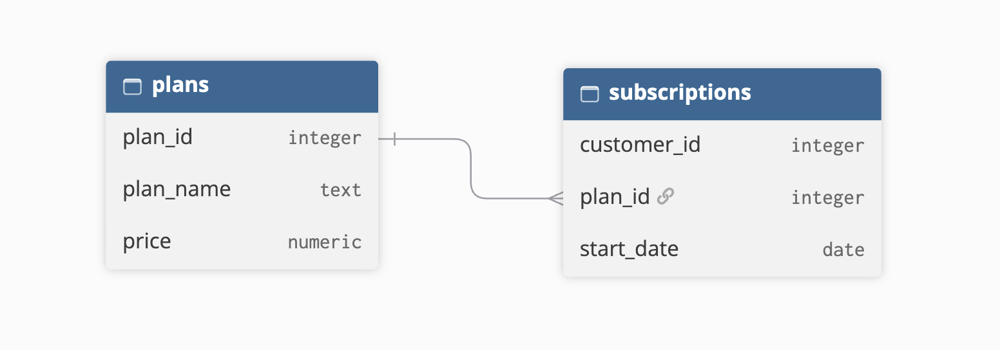

# 🥑 Case Study #3: Foodie-Fi

<p align="center">
<br>
  <strong>Source:</strong> <a href="https://8weeksqlchallenge.com/case-study-3/">8 Week SQL Challenge: Case Study #3 - Foodie-Fi </a>
</p>

## Table of Contents
- [Objective](#objective)
- [Entity Relationship Diagram](#entity-relationship-diagram)
- [Question & Solution](#question-and-solution)
- [Challenges](#challenges)
- [Key Takeaways](#key-takeaways)
  
## Objective
Danny created a new streaming service that only had food related content called Foodie-Fi. This case study aims to help Danny answer important business question using subscription style digital data.

## Entity Relationship Diagram
There are 2 key datasets for this case study:
- `plans` : shows the name for each `plan_id` and the price
- `subscriptions` : shows all customer orders

<p align="center">

</p>
  
## Question & Solution
### A. Customer Journey
Based off the 8 sample customers provided in the sample from the subscriptions table, write a brief description about each customer’s onboarding journey.

*Sample of `subscription` table*

<br>

```SQL
SELECT s.customer_id, s.plan_id, p.plan_name, s.start_date FROM subscriptions s
INNER JOIN plans p
    ON s.plan_id = p.plan_id
WHERE customer_id IN (1, 2, 11, 13, 15, 16, 18, 19);
```

**Result**:

For this section, I will focus on three customers and share their onboarding journey.

Customer 2 joined the free trial on September 20, 2020. After the end of the 7 day trial, Customer 2 subscribed to the pro annual plan on September 27, 2020.

<br>

Customer 15 initially started their subscription with a free trial on March 17, 2020. After the end of their 7 day trial, Customer 15 was automatically subscribed to the pro monthly plan on March 24, 2020. They then cancelled their Foodie-Fi service on April 29, 2020. 

<br>

Customer 16 initially started their subscription with a free trial on May 31, 2020. After the end of their 7 day trial, Customer 16 subscribed to the basic monthly plan on June 7, 2020. They then upgraded their plan to the pro annual on October 10, 2020.

<br>

### B. Data Analysis Questions

**1. How many customers has Foodie-Fi ever had?**
```SQL
SELECT COUNT(DISTINCT(customer_id)) FROM subscriptions;
```

**Result**:

<br>


**2. What is the monthly distribution of trial plan start_date values for our dataset - use the start of the month as the group by value**
```SQL
SELECT 
    TO_CHAR(s.start_date, 'MM - MONTH') AS month,
    COUNT(s.plan_id)
FROM subscriptions s
INNER JOIN plans p
    ON s.plan_id = p.plan_id
WHERE s.plan_id = 0
GROUP BY TO_CHAR(s.start_date, 'MM - MONTH')
ORDER BY month;
```

**Result**:

<br>


**3. What plan start_date values occur after the year 2020 for our dataset? Show the breakdown by count of events for each plan_name**
```SQL
SELECT 
    p.plan_name,
    COUNT(s.plan_id)
FROM subscriptions s
INNER JOIN plans p
    ON s.plan_id = p.plan_id
WHERE EXTRACT(YEAR FROM s.start_date) > '2020'
GROUP BY s.plan_id, p.plan_name
ORDER BY s.plan_id;
```

**Result**:

<br>


**4. What is the customer count and percentage of customers who have churned rounded to 1 decimal place?**
```SQL
WITH customer_count_cte AS(
    SELECT 
        p.plan_name,
        COUNT(s.customer_id) AS customer_count
    FROM subscriptions s
    INNER JOIN plans p
        ON s.plan_id = p.plan_id
    WHERE s.plan_id = 4
    GROUP BY p.plan_name
)
SELECT
    customer_count AS customer_count,
    ROUND((customer_count * 1.0 / NULLIF((SELECT COUNT(DISTINCT (customer_id)) FROM subscriptions), 0)) * 100, 1) AS percentage
FROM customer_count_cte;
```

**Result**:

<br>


**5. How many customers have churned straight after their initial free trial - what percentage is this rounded to the nearest whole number?**
```SQL
WITH plan_status_cte AS(
    SELECT
        customer_id,
        LAG(plan_id) OVER (PARTITION BY customer_id ORDER BY start_date) AS previous_plan,
        plan_id AS current_plan
    FROM subscriptions
)
SELECT 
    COUNT(customer_id) AS customer_count,
    ROUND((COUNT(customer_id) * 1.0 / NULLIF((SELECT COUNT(DISTINCT(customer_id)) FROM subscriptions), 0)) * 100, 0) AS churn_percentage
FROM plan_status_cte
WHERE previous_plan = 0 AND current_plan = 4;
```

**Result**:

<br>


**6. What is the number and percentage of customer plans after their initial free trial?**
```SQL
WITH next_plan_cte AS(
    SELECT
        plan_id,
        customer_id,
        LEAD(plan_id)OVER(PARTITION BY customer_id ORDER BY plan_id) AS next_plan
    FROM subscriptions s
)
SELECT
    p.plan_name,
    COUNT(np.customer_id) AS customer_count,
    ROUND((COUNT(np.customer_id) * 1.0/ (SELECT COUNT(DISTINCT (customer_id)) FROM subscriptions)) * 100, 1) AS percentage
FROM next_plan_cte np
INNER JOIN plans p
    ON np.next_plan = p.plan_id
WHERE np.next_plan IS NOT NULL AND np.plan_id = 0
GROUP BY p.plan_name, np.next_plan
ORDER BY np.next_plan;
```

**Result**:

<br>


**7. What is the customer count and percentage breakdown of all 5 plan_name values at 2020-12-31?**
```SQL
WITH plan_count_cte AS(
    SELECT
        p.plan_name,
        COUNT(DISTINCT s.customer_id) AS customer_count
    FROM (
        SELECT customer_id, plan_id,
            ROW_NUMBER() OVER(PARTITION BY customer_id ORDER BY start_date DESC) AS current_status
        FROM subscriptions
        WHERE start_date <= '2020-12-31'
    ) s
    INNER JOIN plans p
        ON s.plan_id = p.plan_id
    WHERE s.current_status = 1
    GROUP BY p.plan_id, p.plan_name
    ORDER BY p.plan_id
)
SELECT
    plan_name,
    customer_count,
    ROUND((customer_count * 1.0 / (SELECT COUNT(DISTINCT(customer_id)) FROM subscriptions)) * 100, 1) AS percentage
FROM plan_count_cte;
```

**Result**:

<br>


**8. How many customers have upgraded to an annual plan in 2020?**
```SQL
SELECT
    COUNT(DISTINCT s.customer_id) AS customer_count
FROM (
    SELECT customer_id, plan_id,
        ROW_NUMBER() OVER(PARTITION BY customer_id ORDER BY start_date DESC) AS current_status
    FROM subscriptions
    WHERE EXTRACT(YEAR FROM start_date) = '2020' AND plan_id = 3
) s
WHERE s.current_status = 1
```

**Result**:

<br>


**9. How many days on average does it take for a customer to an annual plan from the day they join Foodie-Fi?**
```SQL
WITH trial_cte AS(
    SELECT
        customer_id,
        start_date AS trial_date
    FROM subscriptions
    WHERE plan_id = 0
), 
annual_cte AS(
    SELECT
        customer_id,
        start_date AS annual_date
    FROM subscriptions
    WHERE plan_id = 3
)
SELECT
    ROUND(AVG(ac.annual_date - tc.trial_date),0) AS avg_days
FROM trial_cte tc
INNER JOIN annual_cte ac
    ON tc.customer_id = ac.customer_id;
```

**Result**:

<br>


**10. Can you further breakdown this average value into 30 day periods (i.e. 0-30 days, 31-60 days etc)**
```SQL
WITH trial_cte AS(
    SELECT
        customer_id,
        start_date AS trial_date
    FROM subscriptions
    WHERE plan_id = 0
), 
annual_cte AS(
    SELECT
        customer_id,
        start_date AS annual_date
    FROM subscriptions
    WHERE plan_id = 3
),
day_difference_cte AS(
    SELECT 
        WIDTH_BUCKET(ac.annual_date - tc.trial_date, 0, 365, 12) AS avg_days
    FROM trial_cte tc
    INNER JOIN annual_cte ac
        ON tc.customer_id = ac.customer_id
)
SELECT
    ((avg_days - 1) * 30 || '-' || avg_days * 30 || ' days') AS bucket_days,
    COUNT(*)
FROM day_difference_cte
GROUP BY avg_days
ORDER BY avg_days
```

**Result**:

<br>


**11. How many customers downgraded from a pro monthly to a basic monthly plan in 2020?**
```SQL
WITH plan_status_cte AS(
    SELECT
        customer_id,
        LAG(plan_id) OVER (PARTITION BY customer_id ORDER BY start_date) AS previous_plan,
        plan_id AS current_plan,
        start_date
    FROM subscriptions
)
SELECT COUNT(*)
FROM plan_status_cte
WHERE previous_plan = 2 AND current_plan = 1 AND EXTRACT(YEAR FROM start_date) = '2020';
```

**Result**:

<br>


### C. Challenge Payment Question
The Foodie-Fi team wants you to create a new payments table for the year 2020 that includes amounts paid by each customer in the subscriptions table with the following requirements:

- monthly payments always occur on the same day of month as the original start_date of any monthly paid plan
- upgrades from basic to monthly or pro plans are reduced by the current paid amount in that month and start immediately
- upgrades from pro monthly to pro annual are paid at the end of the current billing period and also starts at the end of the month period
- once a customer churns they will no longer make payments


### D. Outside The Box Questions

## Challenge
## Key Takeaway
