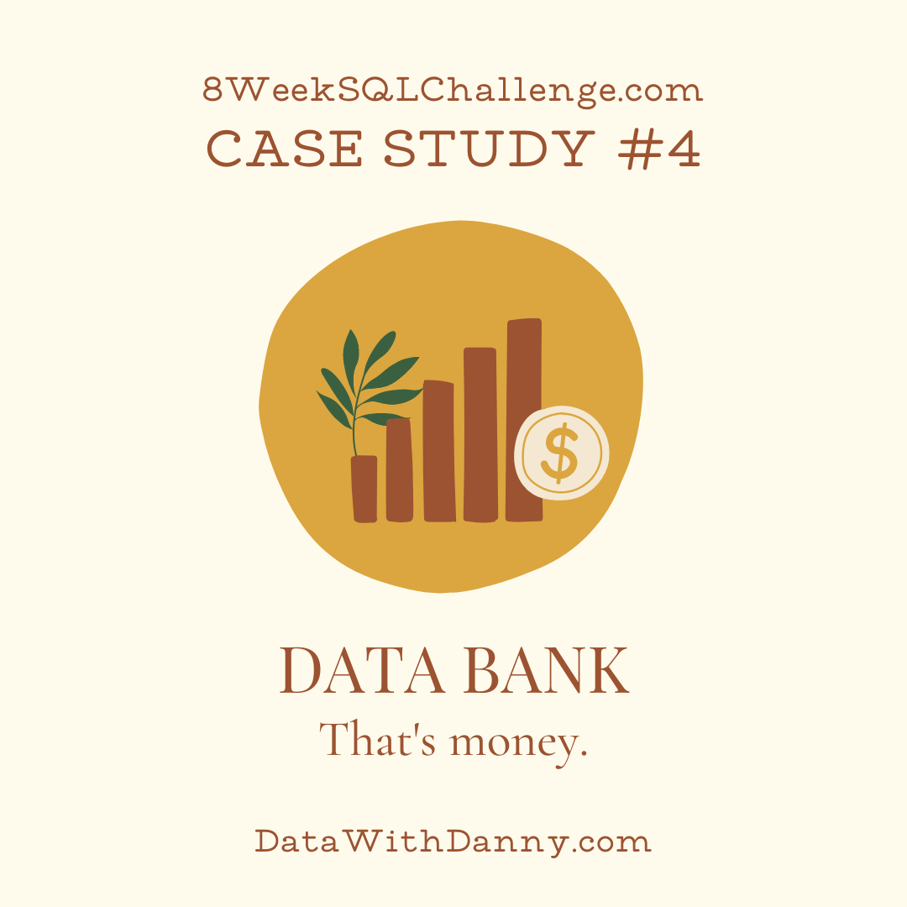
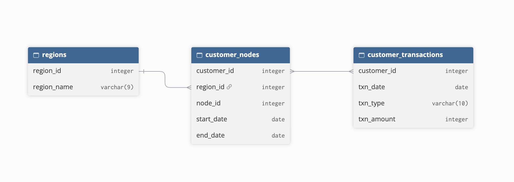

# 💰 Case Study #4: Data Bank

<p align="center">
  <br>
  <strong>Source:</strong> <a href="https://8weeksqlchallenge.com/case-study-4/">8 Week SQL Challenge: Case Study #4 - Data Bank</a>
</p>

## Table of Contents
- [Objective](#objective)
- [Entity Relationship Diagram](#entity-relationship-diagram)
- [Question & Solution](#question-and-solution)
- [Challenges](#challenges)
- [Key Takeaways](#key-takeaways)

## Objective
Data Bank is more than a digital banking system, it's also the world's most secure distributed data storage platform! Created by Danny, customers are allocated cloud data storage limits which are directly linked to hoe much money they have in their account. The management team at Data Bank wants to increase their total customer base and use customer data to understand customer needs.

## Entity Relationship Diagram
There are 3 key datasets in this case study.
- `regions` : both a customer's money and data is stored across the region in a network of nodes, which can be seen as bank branches/ stores
- `customer_nodes` : customers are randomly distributed across the nodes according to their region to reduce the risk of hackers stealing information
- `customer_transaction` : Stores all customers deposits, withdrawals and purchases made using their Data Bank debit card

<p align="center">

</p>

## Question & Solution
### A. Customer Nodes Exploration
**1. How many unique nodes are there on the Data Bank system?**
- Use COUNT() with DISTINCT to find the number of unique nodes
  
```SQL
SELECT COUNT(DISTINCT node_id) FROM customer_nodes;
```

**Result**:

<br>
- Data Bank has 5 unique nodes.

**2. What is the number of nodes per region?**
- Use JOIN to get the name for each region

```SQL
SELECT 
    r.region_name,
    COUNT(DISTINCT n.node_id)
FROM customer_nodes n
INNER JOIN regions r
    ON n.region_id = r.region_id
GROUP BY r.region_name
ORDER BY r.region_name;
```

**Result**:

<br>
- Each region has 5 unique nodes.

**3. How many customers are allocated to each region?**
- Use JOIN to get the name for each region and a COUNT() with DISTINCT to find the number of customers per region

```SQL
SELECT 
    r.region_name,
    COUNT(DISTINCT n.customer_id)
FROM customer_nodes n
INNER JOIN regions r
    ON n.region_id = r.region_id
GROUP BY r.region_name
ORDER BY r.region_name;
```

**Result**:

<br>
- Australia has the highest count with 110 customers in comparison to Europe who only has total of 88 customers.

**4. How many days on average are customers reallocated to a different node?**
- Find the earliest and latest dates using MIN and MAX. After identifying that the maximum `end_date` is '9999-12-31', I checked the rest of the `end_date` in descending order to see if there is any odd dates as well
- After confirming there isn't, I use AVG() to find the difference of days between `end_date` and `start_date` and ROUND() to 2 decimal places
- Filter the results so that the `end_date` doesn't contain '9999-12-31' 
  
```SQL
SELECT 
    MIN(start_date),
    MAX(end_date)
FROM customer_nodes;

SELECT 
    DISTINCT(end_date)
FROM customer_nodes
ORDER BY end_date DESC;

SELECT 
    ROUND(AVG(end_date - start_date),2) AS avg_days
FROM customer_nodes
WHERE end_date != '9999-12-31';
```

**Result**:

<br>
- On average, customer's remain in a node for about 14.63 days or 15 days.
- After checking that all customers have '9999-12-31' in their `end_date`, this suggests that '9999-12-31' is a placeholder that represents the current node that the customer is in. 

**5. What is the median, 80th and 95th percentile for this same reallocation days metric for each region?**
- Find the days between `end_date` and `start_date`
- Filter results so that the `end_date` doesn't contain '9999-12-31'
- Use PERCENTILE_COUNT() to find the specific percentile values across the sorted set of numbers

```SQL
WITH days_cte AS(
    SELECT 
        region_id,
        customer_id,
        (end_date - start_date) AS days
    FROM customer_nodes
    WHERE end_date != '9999-12-31'
    GROUP BY region_id, customer_id, end_date, start_date
)
SELECT
    r.region_name,
    PERCENTILE_CONT(0.5) WITHIN GROUP (ORDER BY d.days) AS median,
    PERCENTILE_CONT(0.8) WITHIN GROUP (ORDER BY d.days) AS percentile_80,
    PERCENTILE_CONT(0.95) WITHIN GROUP (ORDER BY d.days) AS percentile_95
FROM days_cte d
INNER JOIN regions r
    ON d.region_id = r.region_id
GROUP BY r.region_name
ORDER BY r.region_name;
```

**Result**:

<br>
- All of the regions share the same median of 15 days and a 95th percentile of 28 days. For the 80th percentile, Africa and Europe share 24 days while the remaining regions share 23.
- While all the regions are closely similar, Africa and Europe appear to be only a day behind when it comes to reallocating their customers.

### B. Customer Transactions
**1. What is the unique count and total amount for each transaction type?**
- Use COUNT() to find the number per transaction type and SUM() to find the total amount for each transaction type

```SQL
SELECT 
    txn_type,
    COUNT(txn_type),
    SUM(txn_amount)
FROM customer_transactions
GROUP BY txn_type
ORDER BY txn_type;
```

**Result**:

<br>
- Deposit has the highest count (2671) and total amount ($1,259,168). In comparison to withdrawal, who has the lowest count (1580) and total amount ($793,003). This suggests depositing money into the Data Bank system, is a popular feature for customers.

**2. What is the average total historical deposit counts and amounts for all customers?**
- Similar logic to Q1, but filter results so it returns the count and amount customers deposit into Data Bank
- AVG() the count and amount and ROUND() to 2 decimal places

```SQL
WITH deposit_cte AS(
    SELECT 
        customer_id,
        COUNT(txn_type) AS depo_count,
        SUM(txn_amount) AS depo_sum
    FROM customer_transactions
    WHERE txn_type = 'deposit'
    GROUP BY customer_id
)
SELECT
    ROUND(AVG(depo_count),2) AS deposit_count,
    ROUND(AVG(depo_sum),2) AS deposit_amount
FROM deposit_cte;
```

**Result**:

<br>
- In the past, customers have deposited money into their account about 5 times with average total amount being $2,718.24.

**3. For each month - how many Data Bank customers make more than 1 deposit and either 1 purchase or 1 withdrawal in a single month?**
- Create a CTE to act as a tracker and count the times a customer either deposit, purchase or withdrawals money
- Filter the results so that deposit count is greater than one AND purchase or withdrawal count is exactly one time
- Use EXTRACT() to get the month number and TO_CHAR() to add the name of the month from `txn_date`, then GROUP BY the month

```SQL
WITH count_cte AS(
    SELECT
        customer_id,
        EXTRACT(MONTH FROM txn_date) AS month,
        TO_CHAR(txn_date, 'MON') AS month_name, 
        SUM(CASE WHEN txn_type = 'deposit' THEN 1 ELSE 0 END) AS deposit_count,
        SUM(CASE WHEN txn_type = 'purchase' THEN 1 ELSE 0 END) AS purchase_count,
        SUM(CASE WHEN txn_type = 'withdrawal' THEN 1 ELSE 0 END) AS withdrawal_count
    FROM customer_transactions
    GROUP BY customer_id, month_name, month
)
SELECT
    month_name,
    COUNT(*)
FROM count_cte
WHERE deposit_count > 1 AND (purchase_count = 1 OR withdrawal_count = 1)
GROUP BY month_name, month
ORDER BY month;
```

**Result**:

<br>
- January has the highest count for customers who deposit more than 1 time and has exactly once purchased or withdrawal money from their account.
- This shows that customers where highly conservative using their money in the beginning of the year or the first time they open a Data Bank account. April has a concerningly low amount of customers who meet this requirement, it's possible that the data is incomplete for this month and should be investigated further.

**4. What is the closing balance for each customer at the end of the month?**
- Use DATE_TRUNC() to find the earliest and latest transaction dates across the table
- Use a RECURSIVE CTE to implement all four months per customer even if there is no net change for that month
- Calculate the monthly net change
- LEFT JOIN the monthly net changes into the calendar and use COALESCE() to turn months with no transaction into 0. Use (SUM()OVER) to get each month's closing balance

```SQL

WITH RECURSIVE cte AS(
    SELECT
        customer_id,
        (DATE_TRUNC('month', d.min_date) + INTERVAL '1 month' - INTERVAL '1 day')::DATE AS start_month_end,
        (DATE_TRUNC('month', d.max_date) + INTERVAL '1 month' - INTERVAL '1 day')::DATE AS end_month_end
    FROM (SELECT DISTINCT customer_id FROM customer_transactions) c
    CROSS JOIN (
        SELECT MIN(txn_date) AS min_date, MAX(txn_date) AS max_date
        FROM customer_transactions
    ) d
),
cte2 AS(
    SELECT
        customer_id,
        start_month_end AS month_end,
        end_month_end
    FROM cte

    UNION ALL

    SELECT
        customer_id,
        (DATE_TRUNC('month', month_end + INTERVAL '1 day') + INTERVAL '1 month' - INTERVAL '1 day')::DATE,
        end_month_end
    FROM cte2
    WHERE month_end < end_month_end
),
cte3 AS(
    SELECT
        customer_id,
        (DATE_TRUNC('month', txn_date) + INTERVAL '1 month' - INTERVAL '1 day')::DATE AS month_end,
        SUM(CASE WHEN txn_type = 'deposit' THEN txn_amount ELSE -txn_amount END) AS net_change
    FROM customer_transactions
    GROUP BY customer_id, DATE_TRUNC('month', txn_date)
),
cte4 AS (
    SELECT
        c2.customer_id,
        c2.month_end,
        COALESCE(c3.net_change, 0) AS net_change,
        SUM(COALESCE(c3.net_change, 0)) OVER(PARTITION BY c2.customer_id ORDER BY c2.month_end) AS closing_balance
    FROM cte2 c2
    LEFT JOIN cte3 c3
        ON c3.customer_id = c2.customer_id
        AND c3.month_end = c2.month_end
)
SELECT * 
FROM cte4
ORDER BY customer_id, month_end;
```

**Result**:

*Not all output is shown, only the first 3 customers are displayed*
<br>

**5. What is the percentage of customers who increase their closing balance by more than 5%?**
- EXTRACT() the month number and use TO_CHAR() to assign names for each month for readability
- Calculate for the net_change and use (SUM()OVER) to find the closing balance
- Compare each closing balance to the previous row using lag and use NULLIF() to avoid dividing by zero
- Filter results so customers who balance grew by more than 5% are kept

```SQL

WITH cte AS(
    SELECT
        customer_id,
        EXTRACT(MONTH FROM txn_date) AS month,
        TO_CHAR(txn_date, 'MON') AS month_end,
        SUM(CASE WHEN txn_type = 'deposit' THEN txn_amount ELSE -txn_amount END) AS net_change
    FROM customer_transactions
    GROUP BY customer_id, month, month_end
),
cte2 AS(
    SELECT
        customer_id,
        month_end,
        month,
        SUM(net_change) OVER(PARTITION BY customer_id ORDER BY month) AS closing_balance
    FROM cte
    GROUP BY customer_id, month_end, month, net_change
),
cte3 AS(
    SELECT
        customer_id,
        month_end,
        closing_balance,
        100 *(closing_balance - LAG(closing_balance) OVER(PARTITION BY customer_id ORDER BY	month))
            / NULLIF( LAG(closing_balance) OVER(PARTITION BY customer_id ORDER BY	month), 0) AS percentage_increase
    FROM cte2
    GROUP BY customer_id, month_end, month, closing_balance
)
SELECT
    100 * COUNT(DISTINCT customer_id) / (SELECT COUNT(DISTINCT customer_id) FROM customer_transactions)::FLOAT AS percentage
FROM cte3
WHERE percentage_increase > 5;
```

**Result**:

<br>
- About 75.8% of customers had an increase in their closing balance by more than 5%.

  
## Challenges
## Key Takeaways
