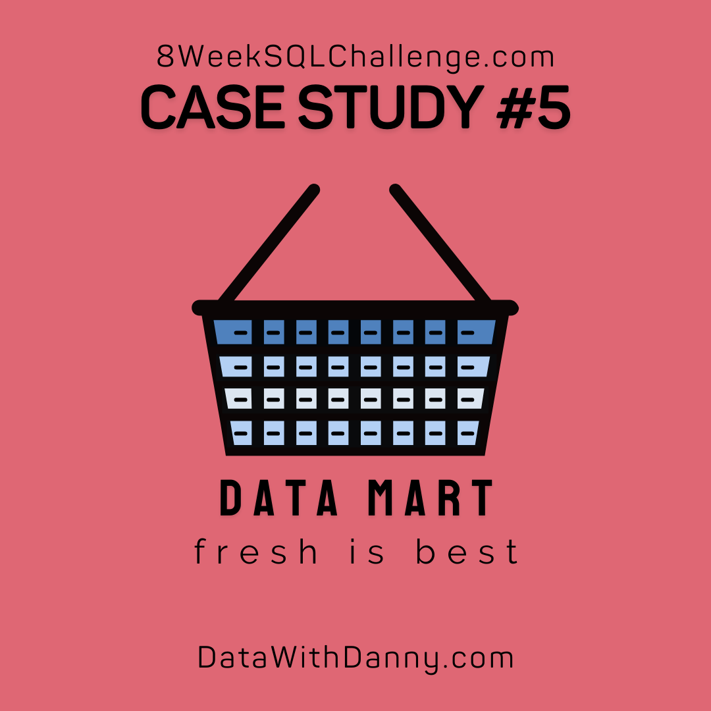
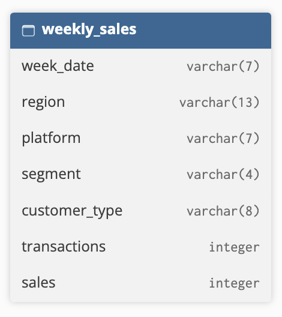

# 🛒 Case Study #5: Data Mart

   
  <strong>Source:</strong> <a href="https://8weeksqlchallenge.com/case-study-5/">8 Week SQL Challenge: Case Study #5 - Data Mart</a>

## Table of Contents
- [Objective](#objective)
- [Entity Relationship Diagram](#entity-relationship-diagram)
- [Question & Solution](#question-and-solution)
- [Key Takeaways](#key-takeaways)
- [Challenges](#challenges)

## Objective
Data Mart is Danny's latest venture, an international online supermarket specialized in fresh produce. In June 2020, large scale supply changes were implemented at Data Mart as products now used a sustainable packaging method. Danny wants to know how these changes impacted sales performance and answer key business questions, such as:
1. What was the quantifiable impact of the changes introduced in June 2020?
2. Which platform, region, segment and customer types were the most impacted by this change?
3. What can we do about future introduction of similar sustainability updates to the business to minimise impact on sales?

## Entity Relationship Diagram
There is only one dataset for this case study:
- `weekly_sales` : the table lists valuable customer insight, such as the week order's where made and from what region, what platform was used to order, customer information, along with transaction and sales.

## Question and Solution

This is a lengthy case study, thus, it is divided into four sections:

[1. Data Cleansing Steps](https://github.com/renalcalde/Data-Projects/blob/main/8%20Week%20SQL%20Challenge/Case%20Study%20%235%3A%20Data%20Mart/Solutions/1.%20Data%20Cleansing%20Steps.md): Clean weekly sales and create a new table with this new information

[2. Data Exploration](https://github.com/renalcalde/Data-Projects/blob/main/8%20Week%20SQL%20Challenge/Case%20Study%20%235%3A%20Data%20Mart/Solutions/2.%20Data%20Exploration.md): Explore and understand the dataset

[3. Before & After Analysis](https://github.com/renalcalde/Data-Projects/blob/main/8%20Week%20SQL%20Challenge/Case%20Study%20%235:%20Data%20Mart/Solutions/3.%20Before%20&%20After%20Analysis.md): Analyze the dataset to understand the impact of the new change

[4. Bonus Question](https://github.com/renalcalde/Data-Projects/blob/main/8%20Week%20SQL%20Challenge/Case%20Study%20%235%3A%20Data%20Mart/Solutions/4.%20Bonus%20Question.md): Further explore the impact of the new change 

View the [full code](https://github.com/renalcalde/Data-Projects/blob/main/8%20Week%20SQL%20Challenge/Case%20Study%20%235%3A%20Data%20Mart/solutions/data_mart.sql)

## Key Takeaways

### Business Insights

After cleaning, exploring and analyzing the data, we can now return back to answering Danny's main questions:

**1. What was the quantifiable impact of the changes introduced in June 2020?**
   
To understand the impacts of these changes, we can look at the transactions and sales from the dataset in addition to calculating the growth rate.

**2. Which platform, region, segment and customer types were the most impacted by this change?**

  - Platform: Both Retail and Shopify were heavily influenced by these changes. Retail is in the lead to Shopify when it comes to total sales but experienced a decline of -0.59% in growth rate. This compares with Shopify whose growth rate increased to 9.35%. This suggests after the implementation of the new sustainable packaging method, online orders have increased, demonstrating the support of our changes.
  - Region: Europe has a growth rate of 4.96% while Asia has a -1.33% growth rate.
  - Segment: Unknown in both demographics and age band have a -0.55% growth rate.
  - Customer types: Existing (-0.51%) and guest (-0.46%) faced a decline in their growth rate but new customers faced an increase (0.69%). The new changes appear to be popular and gain new customers to Data Mart, but existing customers don't appear to be pleased with the new changes. It's possible that loyal customers aren't happy with this new change because they either preferred our previous packaging methods which is why they keep on returning or the new method doesn't hold up to standards and we're unaware of the issues. An investigation is further needed to understand the decline behind existing customers.
  
**3. What can we do about future introduction of similar sustainability updates to the business to minimise impact on sales?**

To minimize sales for future updates we can do the following:
- Let customer's know about our changes via online newsletter or social media
- Running small pilot tests and utilizing customer feedbacks
- Protecting price margin, maybe even offering a discount to roll out remaining supplies
- Market the new change as convenient and durable to build trust with customers before officially launching

### Technical Skills

- Using the GROUPING() function to call upon multiple columns and condense into a single column
- Using TO_CHAR with INTERVAL to look at a certain time period from from a baseline date
- Using LEFT() or SUBSTRING() to find a character in a string at a specific position
- Expanding and practicing my knowledge of the JOIN clause, using it in various scenarios such as LEFT JOIN, FULL JOIN and etc

## Challenges
- In Part 1 (Data Cleansing Steps), finding a way to split the `segment` column to look at a specific character took a bit of time. I didn't want to split the `segment` column first then look at each row to identify what demographic or age band was the combination, so after much research, I came across using CASE LEFT() and CASE SUBSTRING() to create the additional columns with customer information.
- Q2 from Part 2 (Data Exploration) took some time as I had to figure out a way to generate the missing week numbers in `clean_weekly_sales`. That's when I found GENERATE_SERIES() to create the sequence of numbers without needing a physical table.
- For Part 4 (Bonus Question), I struggled to group the following columns without the percentage values being disproportionate. That's when I found the solution to my problem by using the GROUPING() function to combine all my columns into a single column without impacting values.  
