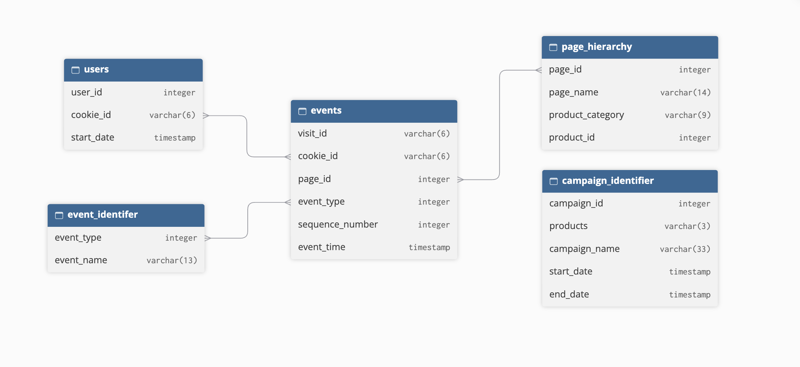

# 🪝 Case Study #6: Clique Bait

   
  <strong>Source:</strong> <a href="https://8weeksqlchallenge.com/case-study-6/">8 Week SQL Challenge: Case Study #6 - Clique Bait</a>

## Table of Contents
- [Objective](#objective)
- [Entity Relationship Diagram](#entity-relationship-diagram)
- [Question & Solution](#question-and-solution)
- [Key Takeaways](#key-takeaways)
- [Challenges](#challenges)

## Objective
Danny wants to expand his knowledge about the seafood industry through his online seafood store, Clique Bait. Using the data he has collected, Danny needs help finding ways to calculate the funnel fallout rates and evaluating how his marketing campaigns affect conversion. This analysis shows how customers move through his website and provides the insights he needs to take the next step in growing his business.

## Entity Relationship Diagram
There are 5 available datasets in this case study:
- `users` : customers who visit the Clique Bait website are tagged via their `cookie_id`
- `events` : customer visits are then logged
- `event_identifier` : shows the type of events that are captured in Clique Bait's digital data systems
- `campaign_identifier` : shows information about the 3 campaigns that Clique Bait has ran on their website so far in 2020
- `page_hierarchy` : lists all the pages on the Clique Bait website

## Question and Solution

[1. Enterprise Relationship Diagram](https://github.com/renalcalde/Data-Projects/blob/main/8%20Week%20SQL%20Challenge/Case%20Study%20%236%3A%20Clique%20Bait/solutions/1.%20Enterprise%20Relationship%20Diagram.md)

## Key Takeaways
## Challenges
