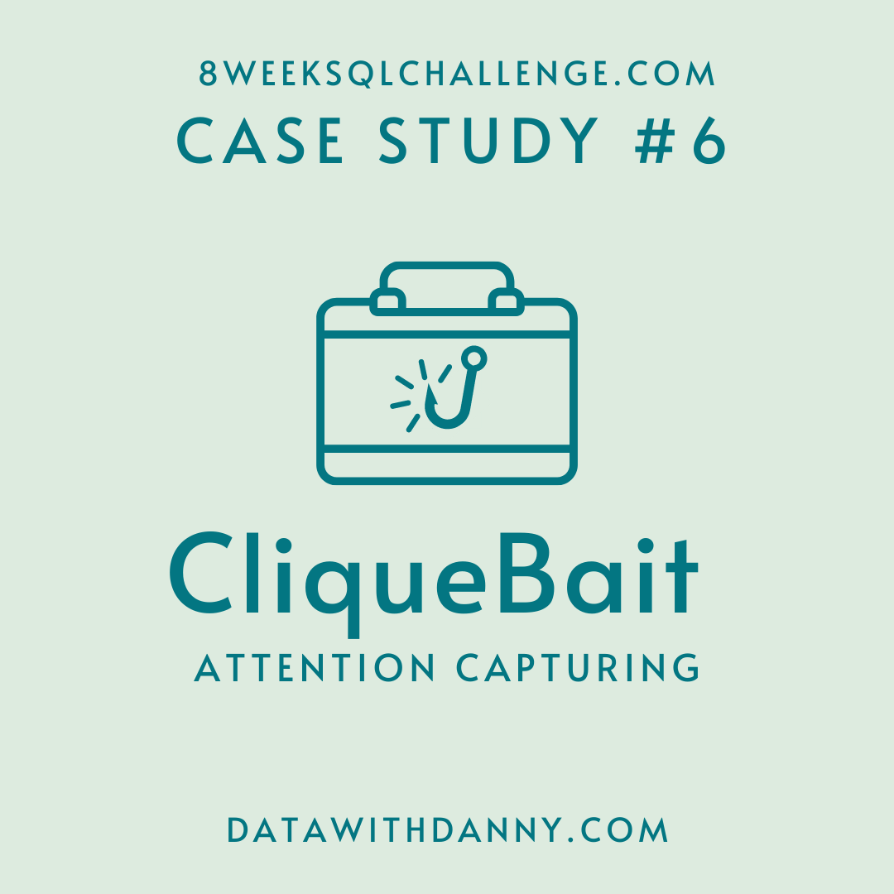

# 🪝 Case Study #6: Clique Bait

   
  <strong>Source:</strong> <a href="https://8weeksqlchallenge.com/case-study-6/">8 Week SQL Challenge: Case Study #6 - Clique Bait</a>

## Table of Contents
- [Objective](#objective)
- [Entity Relationship Diagram](#entity-relationship-diagram)
- [Question & Solution](#question-and-solution)
- [Key Takeaways](#key-takeaways)
- [Challenges](#challenges)

## Objective
Danny wants to expand his knowledge about the seafood industry through his online seafood store, Clique Bait. Using the data he has collected, Danny needs help finding ways to calculate the funnel fallout rates and evaluating how his marketing campaigns affect conversion. This analysis shows how customers move through his website and provides the insights he needs to take the next step in growing his business.

## Entity Relationship Diagram
There are 5 available datasets in this case study:
- `users` : customers who visit the Clique Bait website are tagged via their `cookie_id`
- `events` : customer visits are then logged
- `event_identifier` : shows the type of events that are captured in Clique Bait's digital data systems
- `campaign_identifier` : shows information about the 3 campaigns that Clique Bait has ran on their website so far in 2020
- `page_hierarchy` : lists all the pages on the Clique Bait website

## Question and Solution

[1. Enterprise Relationship Diagram](https://github.com/renalcalde/Data-Projects/blob/main/8%20Week%20SQL%20Challenge/Case%20Study%20%236%3A%20Clique%20Bait/solutions/1.%20Enterprise%20Relationship%20Diagram.md): learn how I created the entity relationship diagram on dbdiagram.io

[2. Digital Analysis](https://github.com/renalcalde/Data-Projects/blob/main/8%20Week%20SQL%20Challenge/Case%20Study%20%236%3A%20Clique%20Bait/solutions/2.%20Digital%20Analysis.md): explore the dataset

[3. Product Funnel Analysis](https://github.com/renalcalde/Data-Projects/blob/main/8%20Week%20SQL%20Challenge/Case%20Study%20%236%3A%20Clique%20Bait/solutions/3.%20Product%20Funnel%20Analysis.md): analyzes products and how user's navigate on Clique Bait

[4. Campaigns Analysis](https://github.com/renalcalde/Data-Projects/blob/main/8%20Week%20SQL%20Challenge/Case%20Study%20%236:%20Clique%20Bait/solutions/4.%20Campaigns%20Analysis.md): analyze how campaigns have influence product purchases and view my [campaign performance infographic](./png/clique_bait_infographic.pdf)

View the [full code](https://github.com/renalcalde/Data-Projects/blob/main/8%20Week%20SQL%20Challenge/Case%20Study%20%236%3A%20Clique%20Bait/solutions/clique_bait.sql)

## Key Takeaways

**Business Insights**
- 49.86% of visits ended in a purchase. The three most purchased products were Lobster (754), Oyster (726) and Crab (719).
- Oyster was the most viewed product (1,568), but Lobster had the most cart adds (968), the most purchases (754) and the best view-to-purchase rate (48.75%). Russian Caviar had the lowest rate (44.59%) and the most abandoned carts (249).
- On average, 60.95% of product views led to a cart add and 75.93% of cart adds led to a purchase, so more people drop off between viewing and adding to cart than between adding to cart and buying.
- The overall click-through rate across the three campaigns was 80.19%.
- Among visits that saw an ad, those who clicked purchased 89.65% of the time, compared with 66.22% for those who didn't click. That is an uplift of +23.43 percentage points.
- Visits with no impression purchased 37.92% of the time. Against that baseline, visits with an impression but no click were up +28.30 percentage points, and visits with an impression and a click were up +51.73 points. Clicking is strongly associated with purchasing. People who click were probably more interested to begin with, so this doesn't prove the ads caused the purchases.
- The Shellfish campaign had the most visits (2,388) but a click-through rate of 80.10%, close to the overall average. The Fish campaign had the fewest visits (260) and the highest click-through rate (84.62%). This hints that the Fish ad was more engaging, but with only 260 visits the gap could partly be chance. Possible explanations are a shorter run, a stronger deal (BOGOF) or higher demand for fish.
- Fish (90.91%) and Shellfish (89.85%) had higher purchase rates than Luxury (87.65%). The gap is only about 2 to 3 points, so it's worth investigating, for example whether the price is a barrier, but it's too small to draw a firm conclusion.

**Key Insights**
- Creating a binary flag using a combination of MAX() + CASE to return NULL if a condition doesn't meet in a row or 1 if it does.
- Learning about marketing funnel along with relevant equations such as conversion rates (# of conversion / total audience) and the difference between an uplift value and percentage.
  - Uplift value (absolute) = New value - Baseline value; measures the raw difference between the two groups and often represented as 'pp'
  - Uplift percentage (relative) = (New value - Baseline value / Baseline value) * 100; measures the difference as percentage and represented as '%'

## Challenges
- The hardest part of this case study was getting the conversion rate and uplift calculations right. In my early queries, I didn't filter my groups properly, used the wrong group for some calculations, and reported inaccurate numbers because I didn't understand the difference between absolute uplift (percentage points) and relative uplift (percent). After a lot of trial and error, learning the underlying formulas and repeatedly re-checking my results, I produced numbers that are consistent with the data. This case study taught me to confirm what each number represents before I report it.
