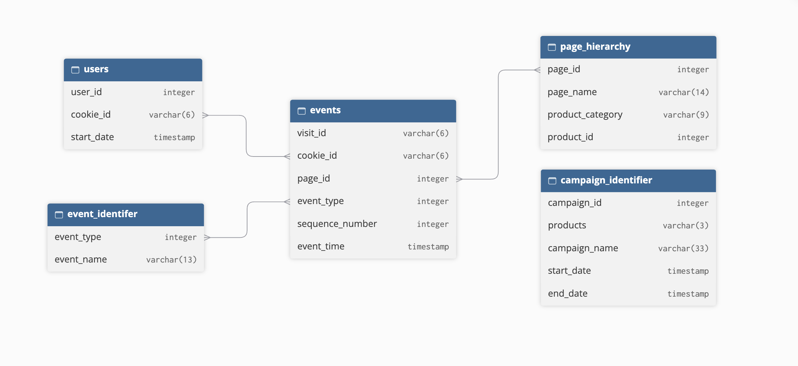

# 1. Enterprise Relationship Diagram

Using the following DDL schema details to create an ERD for all the Clique Bait datasets.

```SQL
CREATE TABLE clique_bait.event_identifier (
  "event_type" INTEGER,
  "event_name" VARCHAR(13)
);

CREATE TABLE clique_bait.campaign_identifier (
  "campaign_id" INTEGER,
  "products" VARCHAR(3),
  "campaign_name" VARCHAR(33),
  "start_date" TIMESTAMP,
  "end_date" TIMESTAMP
);

CREATE TABLE clique_bait.page_hierarchy (
  "page_id" INTEGER,
  "page_name" VARCHAR(14),
  "product_category" VARCHAR(9),
  "product_id" INTEGER
);

CREATE TABLE clique_bait.users (
  "user_id" INTEGER,
  "cookie_id" VARCHAR(6),
  "start_date" TIMESTAMP
);

CREATE TABLE clique_bait.events (
  "visit_id" VARCHAR(6),
  "cookie_id" VARCHAR(6),
  "page_id" INTEGER,
  "event_type" INTEGER,
  "sequence_number" INTEGER,
  "event_time" TIMESTAMP
);
```

---

I used dbdiagram.io to create the entity relationship diagram for all Clique Bait dataset. (Unfortunately, Github README does not render DBML (dbdiagram.io syntax) and also failed to render Mermaid diagrams. Hence, the code is in text.)
  
```
Table users {
  user_id integer
  cookie_id varchar(6)
  start_date timestamp
}

Table events {
  visit_id varchar(6)
  cookie_id varchar(6)
  page_id integer
  event_type integer
  sequence_number integer
  event_time timestamp
}

Table event_identifer {
  event_type integer
  event_name varchar(13)
}

Table campaign_identifier{
  campaign_id integer
  products varchar(3)
  campaign_name varchar(33)
  start_date timestamp
  end_date timestamp
}

Table page_hierarchy{
  page_id integer
  page_name varchar(14)
  product_category varchar(9)
  product_id integer
}

Ref: users.cookie_id <> events.cookie_id
Ref: page_hierarchy.page_id <> events.page_id
Ref: event_identifer.event_type<> events.event_type
```

**Result**:


