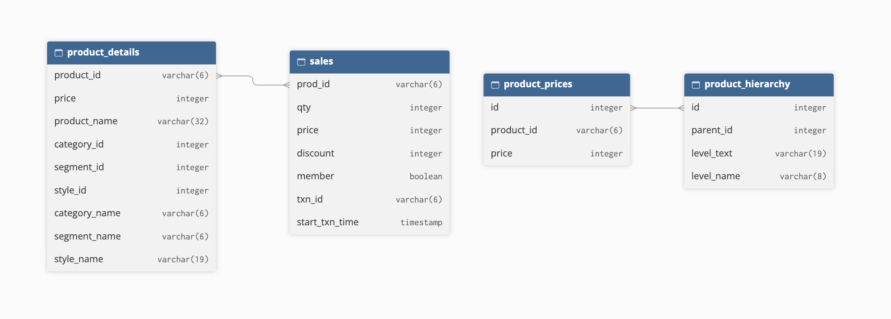

# 🌲 Case Study #7: Balanced Tree Clothing Co.

<p align="center">
  <br>
  <strong>Source:</strong> <a href="https://8weeksqlchallenge.com/case-study-7/">8 Week SQL Challenge: Case Study #7 - Balanced Tree Clothing Co.</a>
</p>

## Table of Contents
- [Objective](#objective)
- [Entity Relationship Diagram](#entity-relationship-diagram)
- [Question & Solution](#question-and-solution)
- [Key Takeaways](#key-takeaways)
- [Challenges](#challenges)

## Objective
CEO Danny needs help to expand his trendy fashion company, Balanced Tree Clothing Co. designed for modern adventurers, analyze their sales performance and generate a basic monthly financial report. 

## Entity Relationship Diagram
There is a total of 4 datasets for this case study, however, we will be utilizing two for the majority of the analysis:
- `product_details` : includes all information about the entire products that Balanced Clothing sells in their store
- `product_sales` : contains product information for all the transactions made for Balanced Tree
  
The following two tables will be used for the bonus question:
- `product_hierarcy` 
- `product_price`

<p align="center">

</p>

## Question and Solution

### A. High Level Sales Analysis

**1. What was the total quantity sold for all products?**
- Use SUM() to get the total count quantity of products across all rows rather than using COUNT() which will only count one product per row

```SQL
SELECT SUM(qty) AS total_qty FROM sales;
```

**Result**:

<br>
- The total quantity sold for all products is 45,216.


**2. What is the total generated revenue for all products before discounts?**
- Total Revenue = Quantity Sold x Price Per Product
- Multiply `qty` to `price` and use SUM() to get the total revenue for all products

```SQL
SELECT
    ROUND(SUM(qty * price), 2) AS gross_revenue
FROM sales;
```

**Result**:

<br>
- The total revenue for all products before discounts are applied is $1,289,453.


**3. What was the total discount amount for all products?**
- Total Discount Amount = Σ(Original Price x Discount % / 100 x Quantity)
- Use SUM() and follow the equation above 

```SQL
SELECT 
    ROUND(SUM(price * (discount / 100.0) * qty), 2) AS total_discount_amt
FROM sales;
```

**Result**:

<br>
- The total discount amount for all products is $156,229.14.


## Key Takeaways

## Challenges
