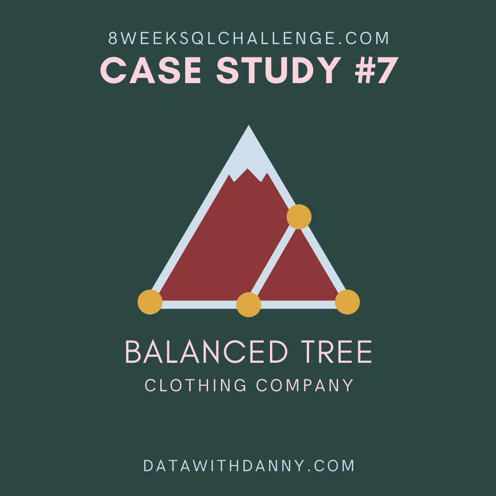

# 🪝 Case Study #7: Balanced Tree Clothing Co.

   
  <strong>Source:</strong> <a href="https://8weeksqlchallenge.com/case-study-7/">8 Week SQL Challenge: Case Study #7 - Balanced Tree Clothing Co.</a>

## Table of Contents
- [Objective](#objective)
- [Entity Relationship Diagram](#entity-relationship-diagram)
- [Question & Solution](#question-and-solution)
- [Key Takeaways](#key-takeaways)
- [Challenges](#challenges)

## Objective
CEO Danny needs help to expand his trendy fashion company, Balanced Tree Clothing Co. designed for modern adventurers, analyze their sales performance and generate a basic monthly financial report. 

## Entity Relationship Diagram
There is a total of 4 datasets for this case study, however, we will be utilizing two for the majority of the analysis:
- `product_details` : includes all information about the entire products that Balanced Clothing sells in their store
- `product_sales` : contains product information for all the transactions made for Balanced Tree
  
The following two tables will be used for the bonus question:
- `product_hierarcy` 
- `product_price`

## Question and Solution

## Key Takeaways

## Challenges
