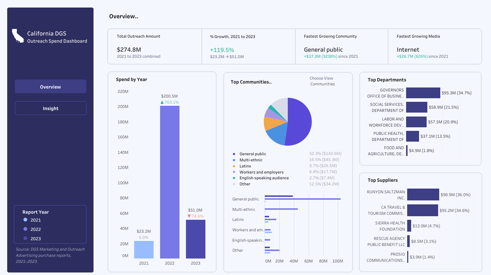
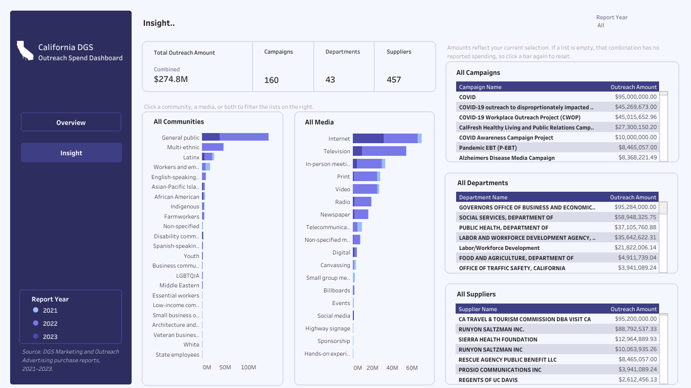

# 🏛️ California Outreach Spending

## Objective
In this project, I aimed to understand how California state agencies spent on demographic-targeted outreach campaigns from 2021 to 2023:
1. Which communities and media channels received the most and least investment over time?
2. Which departments and suppliers account for the largest share of spending?

## Data
- **Source:** [DGS Marketing and Outreach Advertising purchase reports, 2021-2023.](https://catalog.data.gov/dataset/marketing-and-outreach-advertising-materials-purchase?from_hint=eyJxIjoiY2FsaWZvcm5pYSBvdXRyZWFjaCJ9)
  - **Contents:** California state outreach spending reports for 2021, 2022, and 2023, published as separate yearly CSV files. Fields include report year, campaign name, community, department, media type, and spend amount.
  
- **Tools:** PostgreSQL, Tableau
- **Skills:** Data cleaning, data analysis, data visualization

## Approach
1. **Consolidated the data:** Combined the yearly CSV files into a single dataset with consistent column names.
2. **Cleaned and queried:** I cleaned the dataset by handling missing values and placeholder IDs, removed duplicates, and standardized names, then summarized spending in PostgreSQL.
5. **Built a dashboard:** Built an interactive dashboard with two pages; an Overview, which displays the KPIs, spending trend and the top 5 at a glance and the Insight, which displays all the data that can be filtered by year.

## Findings
- Spendings grew significantly from $23.2M in 2021 to $200.5M in 2022 (+763%) but then fell to $51.0M in 2023 (-74.6%).
- Since 2021, the General public had the fastest growing community ($37.3M, 3238%) and the Internet was the fastest growing media type ($26.7M, 626%).
- Covid-19 related campaigns made up most of 2021 (88%) and 2022 (94%), and almost none in 2023. So the drop from 2023 came from Covid-19 campaigns ending, not from agencies cutting outreach amount overall.

  
**Dashboard:** [California DGS Outreach Spend Dashboard](https://public.tableau.com/app/profile/ren.alcalde/viz/CaliforniaDGSOutreachSpendDashboard/overview2)

### Results
Outreach spending was driven by Covid-19 campaigns and concentrated in a few players. It rose from $23.2M in 2021 to $200.5M in 2022, then fell to $51.0M in 2023 as Covid-19 campaigns ended. The General public and the Internet were the fastest-growing community and media type, while two suppliers (Runyon Saltzman Inc. and the CA Travel & Tourism Commission) received about 71% of all spending, and the top 5 departments accounted for about 92%.
