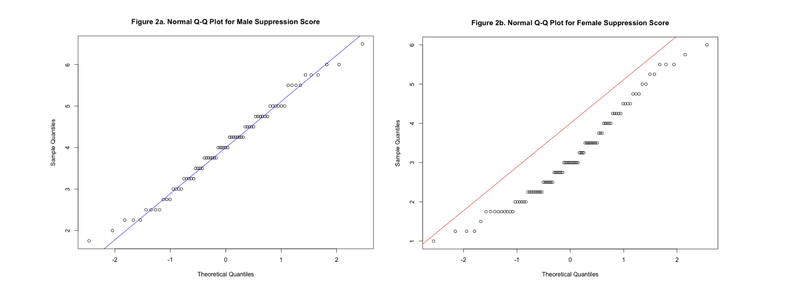
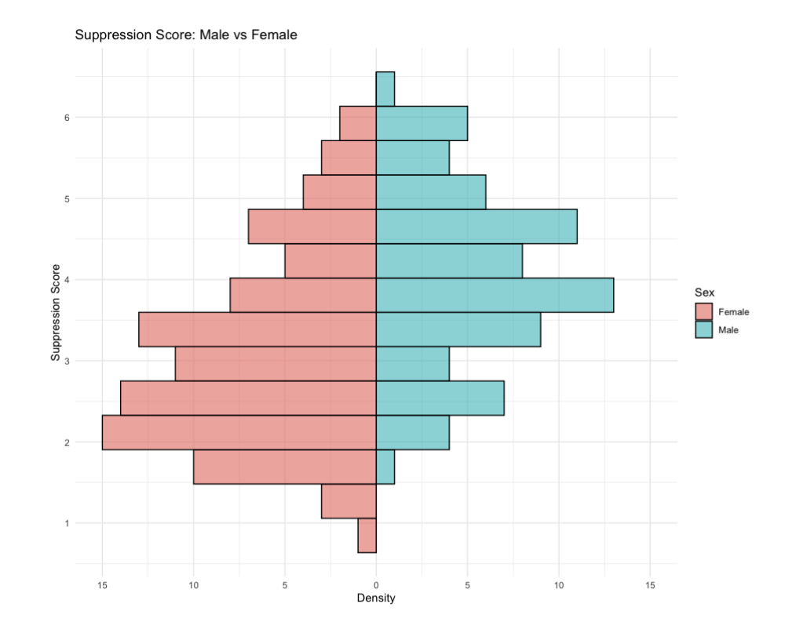

# 🧠 Exploring the Relationship Between Sex and Emotional Suppression

## Objective
As part of my Cognitive Science coursework, I used emotional suppression scores from the "Midlife in the United States (MIDUS 3): Neuroscience Project, 2017-2022" study to test the hypothesis that males report higher emotional suppression than females.

## Data
- **Source:** [Midlife in the United States (MIDUS 3): Neuroscience Project, 2017-2022 (ICPSR 38862)](https://www.icpsr.umich.edu/web/NACDA/studies/38862/export#)
- **Code:** [exploring_the_relationship_between_sex_and_emotional_suppression.R](sex_and_emotional_suppression.R)
- **Sample:** n = 73 males, n = 97 females
- **Measure:** Emotional suppression score, calculated as the average of participants' ratings on several survey items about suppressing emotions (range 1 to 6.5; higher = more suppression)

- **Tools:** R (Hmisc, ggplot2)
- **Skills:** Data analysis, hypothesis testing, t-test, assumption checking, data visualization

## Approach
1. **Set up the data**: I imported the data into R and loaded the required libraries.
2. **Checked assumptions:** Before analyzing the data, I checked for any outliers by conducting a Shapiro-Wilk test of normality for each group. The male group met the assumption, but the female group did not (p = 0.02). Because both groups were large, I still proceeded with a t-test.

4. **Tested the hypothesis:** I then ran a one-tailed t-test since my hypothesis predicted to a specific direction. 
5. **Wrote it up**: After the completion of my analysis, I wrote a in-depth paper with R generated graphs and cited sources. [Read the full academic research paper](academic_research_paper.pdf)

## Findings
- Male participants had a higher suppression score (M = 4.03, SD = 1.08) than female participants (M = 3.15, SD = 1.17).
- The difference was statistically significant: t(167) = 5.03, p < .001. The 95% confidence interval [0.59, ∞) means the true difference is likely at least 0.59 points.
- The data supports rejecting the null hypothesis.

## Results
From these findings, male participants had a higher suppression score than female participants which is consistent with prior research. This analysis shows a difference in scores but cannot explain its cause. Biological and social factors are possible explanations, but they were not tested here. A limitation of the study is that suppression scores was self-reported, so future studies could add other measures that are not reliant on participant perspective to counteract this.
