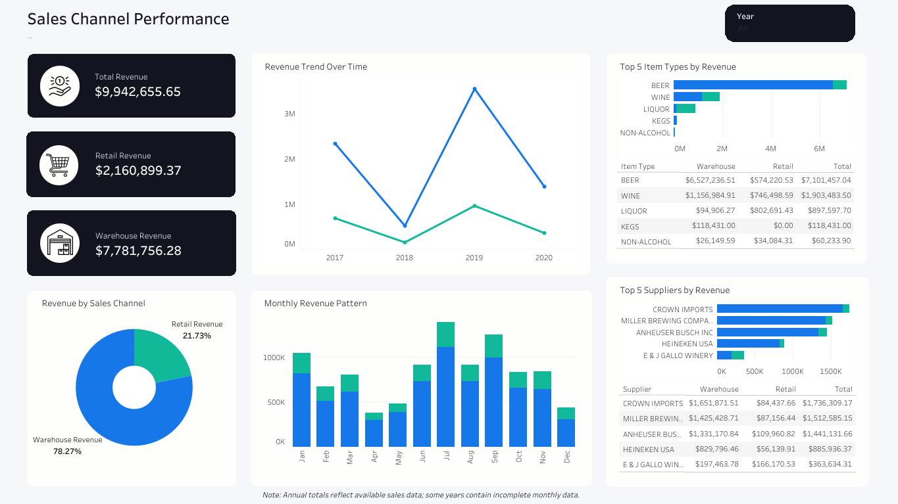

# 🛒 Sales Performance Channel

## Objective
I compared retail and warehouse revenue from a liquor distributor dataset to see how the two channels differ and how revenue changed over time.

## Data
- **Source:** [Warehouse and Retail Sales](https://catalog.data.gov/dataset/warehouse-and-retail-sales?from_hint=eyJxIjoiV2FyZWhvdXNlIGFuZCByZXRhaWwgc2FsZXMiLCJzb3J0IjoicmVsZXZhbmNlIn0%3D)
- **Code:** Not available, see dashboard
  
- **Tools:** PostgreSQL, Tableau
- **Skills:** Data analysis, data cleaning, data visualization

## Approach
1. **Reviewed the data:** Scanned the CSV file to identify what needed to be fixed or reformatted, then loaded it into PostgreSQL.
2. **Cleaning and analyzing the data:** I then cleaned the data by checking for any missing values, removing duplicates, and standardizing names. Then I ran queries comparing total warehouse and retail revenue and identifying the top 5 item types and suppliers.
4. **Build an interactive dashboard:** Created an interactive Tableau dashboard where users can filter by year to see how revenue changed over time, and the top 5 item types and supplier to see who is behind the revenue.

## Findings
- Warehouse revenue ($7.78M) was nearly four times retail revenue ($2.16M), or 78.27% of the total.
- 2019 had the highest total revenue ($4.50M).
- Across all years, beer was the top item type and Crown Imports the top supplier by total revenue, which is driven mostly by warehouse sales.

**Dashboard**:[Sales Channel Performance](https://public.tableau.com/app/profile/ren.alcalde/viz/SalesChannelPerformance_17895329605830/Dashboard)

## Results
Warehouse revenue made up 78.27% of total revenue across all years, and retail warehouse only making up 21.73%. Warehouse revenue was led by beer and by Crown Imports as top supplier. 

## Future Improvement
- The top 5 charts rank by overall revenue, so they mostly reflect warehouse sales. Retail leaders can't be seen separately.
- The top 5 doesn't update when you filter by year.
- Next step: add a channel filter and recalculate the top 5 within each year.
