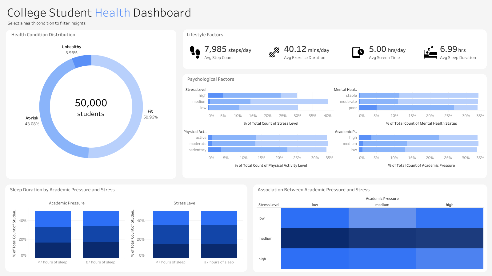

# 🎓 Student Health Dashboard

## Objective
Analyze the College Student Health Behavior Dataset to determine if there is a pattern among fit, at-risk and unhealthy students in regards to lifestyle and psychological factors.

Which lifestyle and academic factors are found in students who are high at risk.

## Data
- **Source:** [College Student Health Behavior Dataset](https://www.kaggle.com/datasets/ziya07/college-student-health-behavior-dataset)
- **Code:** Not available, see dashboard
- **Tools:** PostgreSQL, Tableau
- **Skills:** Data analyzing, data visualization

## Approach

## Findings

Dashboard: [College Student Health Dashboard](https://public.tableau.com/app/profile/ren.alcalde/viz/CollegeStudentHealthDashboard/Overview)

## Results

